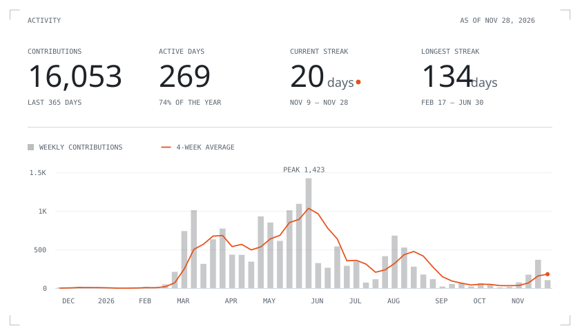

<picture>
  <source media="(prefers-color-scheme: dark)" srcset="assets/headline-dark.svg?v=1" />
  <source media="(prefers-color-scheme: light)" srcset="assets/headline-light.svg?v=1" />
  
</picture>

&nbsp;&nbsp;

---

### Technical Stack

<!-- TECH:LANGUAGES:START -->

<!-- TECH:LANGUAGES:END -->
  

---

### GitHub Activity

<picture>
  <source media="(prefers-color-scheme: dark)" srcset="https://raw.githubusercontent.com/yuhanwang14/yuhanwang14/output/activity-dark.svg" />
  <source media="(prefers-color-scheme: light)" srcset="https://raw.githubusercontent.com/yuhanwang14/yuhanwang14/output/activity-light.svg" />
  
</picture>

  

<picture>
  <source media="(prefers-color-scheme: dark)" srcset="https://raw.githubusercontent.com/yuhanwang14/yuhanwang14/output/activity-chart-dark.svg" />
  <source media="(prefers-color-scheme: light)" srcset="https://raw.githubusercontent.com/yuhanwang14/yuhanwang14/output/activity-chart-light.svg" />
  
</picture>

