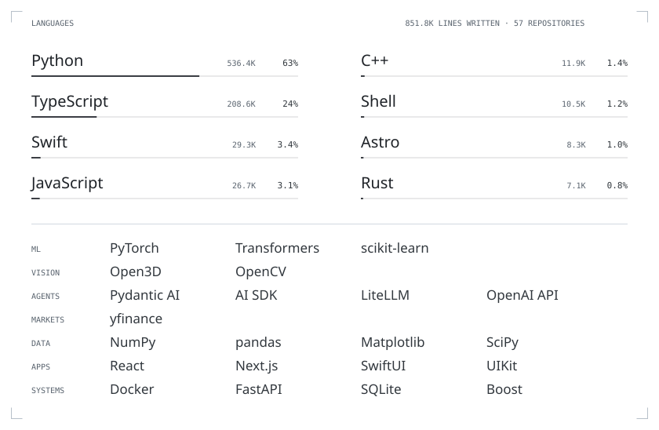

<a href="https://yuhanwang.page/"><picture>
  <source media="(prefers-color-scheme: dark)" srcset="assets/hero-dark.svg?v=2" />
  <source media="(prefers-color-scheme: light)" srcset="assets/hero-light.svg?v=2" />
  </picture></a>

<a href="https://yuhanwang.page/"><picture>
  <source media="(prefers-color-scheme: dark)" srcset="assets/link-website-dark.svg?v=4" />
  <source media="(prefers-color-scheme: light)" srcset="assets/link-website-light.svg?v=4" />
  </picture></a>&nbsp;<a href="https://www.linkedin.com/in/yuhan-wang-5546832a2/"><picture>
  <source media="(prefers-color-scheme: dark)" srcset="assets/link-linkedin-dark.svg?v=4" />
  <source media="(prefers-color-scheme: light)" srcset="assets/link-linkedin-light.svg?v=4" />
  </picture></a>

<picture>
  <source media="(prefers-color-scheme: dark)" srcset="https://raw.githubusercontent.com/yuhanwang14/yuhanwang14/output/languages-dark.svg" />
  <source media="(prefers-color-scheme: light)" srcset="https://raw.githubusercontent.com/yuhanwang14/yuhanwang14/output/languages-light.svg" />
  
</picture>

<picture>
  <source media="(prefers-color-scheme: dark)" srcset="https://raw.githubusercontent.com/yuhanwang14/yuhanwang14/output/activity-dark.svg" />
  <source media="(prefers-color-scheme: light)" srcset="https://raw.githubusercontent.com/yuhanwang14/yuhanwang14/output/activity-light.svg" />
  
</picture>

